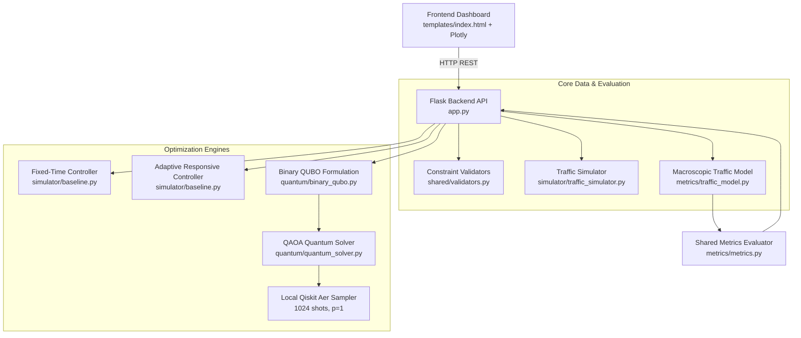

# QuantumFlow 🚦⚛️

**Real-Time Quantum-Classical Hybrid Traffic Signal Optimization**  
*Built for the 2026 Quantum Hackathon*

---

## 1. Problem Statement & Proposed Solution

### The Urban Traffic Challenge
Urban traffic congestion leads to extensive driver delays, stop-and-go energy loss, and inefficient roadway utilization. Traditional traffic light controllers primarily rely on:
- **Fixed-Time Control:** Cycle lengths and green splits remain static regardless of instantaneous queue accumulation.
- **Local Actuated / Responsive Control:** Adjusts splits locally per intersection but struggles to coordinate phase alignments across arterial corridors simultaneously.

### The QuantumFlow Solution
QuantumFlow formulates the multi-intersection signal timing problem as a **Quadratic Unconstrained Binary Optimization (QUBO)** problem. By mapping candidate green-phase allocations to binary decision variables and penalizing desynchronized corridor progression along arterial grid edges, QuantumFlow executes genuine **Quantum Approximate Optimization Algorithm (QAOA)** circuits on local quantum simulators (`Qiskit Aer`).

QuantumFlow benchmarks genuine QAOA execution directly against **Fixed-Time** and **Traffic-Responsive** controllers on **identical simulated traffic snapshots** using a shared, macroscopic traffic evaluation engine.

> [!NOTE]
> **Scientific Honesty & Disclaimer:**
> - All traffic metrics represent **simulated macroscopic estimates** based on deterministic saturation queue equations ($h = 2.0\text{ s/veh}$, $C = \lfloor g/2\rfloor$).
> - For $N = 4$ binary variables ($2^4 = 16$ states), **no quantum speedup exists**. Classical enumeration executes in $< 1\text{ ms}$, while QAOA quantum circuit simulation requires $\sim 180\text{–}400\text{ ms}$ due to statevector/shot-sampling simulation overhead.
> - QuantumFlow demonstrates algorithmic feasibility, Ising Hamiltonian mapping, and fault-resilient hybrid integration without making speculative claims of real-world pollution reduction or quantum advantage at this scale.

---

## 2. Team Structure & Responsibilities

| Role | Primary Modules | Key Responsibilities |
|---|---|---|
| **Classical Controller Lead** | `simulator/baseline.py`, `simulator/traffic_simulator.py` | 4-intersection 2x2 grid simulator, fixed-time (30/30) and adaptive responsive split controllers. |
| **Metrics Engineer** | `metrics/traffic_model.py`, `metrics/metrics.py` | Single source of truth for queue discharge, leftover queues, delay calculations, and percentage reduction vs baseline. |
| **Quantum Engineer** | `quantum/binary_qubo.py`, `quantum/quantum_solver.py`, `quantum/reference_enumerator.py` | 4-variable QUBO formulation, exact algebraic energy proofs, Qiskit Aer QAOA sampler, and constraint decoding. |
| **Backend Engineer** | `app.py`, `api/` | Flask REST API, schema validation, timeout guards, test client suite, and non-fabrication error handling. |
| **Frontend Engineer** | `templates/index.html`, `static/style.css`, `static/dashboard.js` | Interactive dashboard, real-time Plotly charts, density tags, stale input invalidation, and theory documentation. |

---

## 3. System Architecture & Data Flow



---

## 4. Quick Start & Startup Instructions

### Prerequisites
- **Python:** 3.12.4
- **Operating System:** Windows, macOS, or Linux
- **Local Virtual Environment:** `.venv`

### Setup & Launch Commands

```powershell
# 1. Clone Repository
git clone https://github.com/Gagan-03C/VTUXIBM.git
cd VTUXIBM

# 2. Activate Virtual Environment (Windows PowerShell)
.\.venv\Scripts\Activate.ps1
# On Linux / macOS: source .venv/bin/activate

# 3. Verify Dependencies (Qiskit 1.2.4, Qiskit Aer 0.14.2, Flask 3.0.3, NumPy 1.26.4)
pip install -r requirements.txt

# 4. Run Complete Test Suite (428 Tests)
.venv\Scripts\pytest -v

# 5. Launch Backend Server
$env:PORT="5000"
.venv\Scripts\python app.py
```

Open **[http://localhost:5000/](http://localhost:5000/)** in your browser to view the interactive dashboard.

---

## 5. REST API Specification

All endpoints communicate via JSON and adhere strictly to [`docs/INTERFACES.md`](docs/INTERFACES.md).

| Method | Endpoint | Description | Sample Payload / Output |
|---|---|---|---|
| `GET` | `/` | Web dashboard user interface | HTML document with Plotly visualizations |
| `GET` | `/api/traffic` | Current 2x2 traffic queue snapshot | `{"status": "ok", "traffic_input": {...}, "total_vehicles": 227}` |
| `POST` | `/api/traffic` | Update queue counts or set preset scenario | `{"scenario": "heavy", "seed": 42}` or custom queues |
| `POST` | `/api/optimize/baseline` | Run Fixed-Time controller (30s/30s) | Returns timing plan, metrics, and runtime |
| `POST` | `/api/optimize/responsive` | Run Adaptive Responsive controller | Returns proportional splits, delay reduction %, metrics |
| `POST` | `/api/optimize/qaoa` | Run genuine QAOA on Qiskit Aer | Returns measured bitstring, QUBO cost, timing plan, metrics |
| `GET` | `/api/results` | Historical evaluation log | `{"status": "ok", "count": 25, "history": [...]}` |

---

## 6. Mathematical Traffic Model & Classical Controllers

### 6.1 Saturation Queue & Delay Physics
All traffic calculations are centrally evaluated by [`metrics/traffic_model.py`](metrics/traffic_model.py):
- **Cycle Time:** $T_{cycle} = 60\text{ s}$.
- **Minimum / Maximum Green:** $15\text{ s} \le g \le 45\text{ s}$.
- **Saturation Headway:** $h = 2.0\text{ s/veh}$ (Discharge saturation flow $S = 0.5\text{ veh/s}$).
- **Discharge Capacity:** $C(g) = \lfloor g / 2.0 \rfloor\text{ vehicles}$.
- **Leftover Queue:** $rem = \max(0, queue - C(g))$.
- **Accumulated Leftover-Red Delay:** Leftover vehicles endure red delay during opposing phase:
  $$D_i = rem_{i,ns} \cdot ew_{green} + rem_{i,ew} \cdot ns_{green}$$
- **Average Waiting Time:**
  $$W_{avg} = \begin{cases} \frac{D_{total}}{total\_vehicles} & \text{if } total\_vehicles > 0 \\ 0.0 & \text{otherwise} \end{cases}$$

### 6.2 Classical Benchmarks
1. **Fixed-Time Baseline:** Allocates equal $30\text{ s}$ North-South and $30\text{ s}$ East-West green time ($C = 15\text{ veh}$) to all 4 intersections.
2. **Traffic-Responsive Controller:** Dynamically calculates green splits based on the ratio of NS to EW vehicle queues, bounded strictly within $[15\text{ s}, 45\text{ s}]$:
   $$g_{ns} = \text{round}\left(60 \cdot \frac{q_{ns}}{q_{ns} + q_{ew}}\right), \quad g_{ew} = 60 - g_{ns}$$

---

## 7. QUBO Formulation & QAOA Architecture

### 7.1 Decision Variables
For the 4-node 2×2 grid (Intersections A, B, C, D), each intersection $i \in \{0, 1, 2, 3\}$ has a single binary decision variable $x_i \in \{0, 1\}$:
- $x_i = 0$: **Plan 0 (North-South Priority):** $g_{ns} = 45\text{ s}, g_{ew} = 15\text{ s}$ ($C_{ns} = 22, C_{ew} = 7$).
- $x_i = 1$: **Plan 1 (East-West Priority):** $g_{ns} = 15\text{ s}, g_{ew} = 45\text{ s}$ ($C_{ns} = 7, C_{ew} = 22$).

### 7.2 Objective Function
$$E(x) = x^T Q x + c_{offset} = \sum_{i=0}^3 D_i(x_i) + \sum_{(u, v) \in E} \gamma_{uv} (x_u - x_v)^2$$
- **Linear terms (diagonal):** $Q_{ii} = [D_i(1) - D_i(0)] + \sum_{v \in N(i)} \gamma_{iv}$.
- **Quadratic coupling terms (off-diagonal):** $Q_{uv} = -2\gamma_{uv}$ for grid edges $(A,B), (C,D), (A,C), (B,D)$.
- **Offset:** $c_{offset} = \sum_{i=0}^3 D_i(0)$.
- **Exact Equality:** For all $2^4 = 16$ bitstrings, algebraic energy $E(x)$ matches true traffic delay identically ($|E(x) - C_{intended}(x)| = 0.0$).

### 7.3 QAOA Quantum Simulator Pipeline
- **Quantum Simulator:** `qiskit_aer.primitives.Sampler(run_options={"shots": 1024, "seed": 42})`.
- **Ansatz:** $p$-layer alternating operator circuit ($U(C, \gamma) U(B, \beta)$).
- **Classical Optimizer:** `COBYLA` with default `maxiter=50` (or `maxiter=20` in fast demo mode).
- **Decoding:** The highest-probability measured bitstring $b = b_0 b_1 b_2 b_3$ is decoded into candidate signal plans.

---

## 8. Measured Test Results & Benchmarks

Full end-to-end evaluation conducted across preset scenarios ([`scratch/verify_scenarios_e2e.py`](scratch/verify_scenarios_e2e.py)):

| Scenario | Vehicles | Fixed-Time Delay | Responsive Delay | QAOA Delay | QAOA Bitstring | QAOA Cost | Gap $\Delta E$ | QAOA Runtime |
|---|---|---|---|---|---|---|---|---|
| **Light** | 50 veh | 0.0 s | 0.0 s (+0.0%) | 0.0 s (+0.0%) | `0101` | 0.0 | **0.0 s** | 174.9 ms |
| **Medium** | 177 veh | 1,710.0 s | 1,720.0 s (-0.6%) | 2,460.0 s (-43.9%) | `0001` | 2,460.0 | **0.0 s** | 187.7 ms |
| **Heavy** | 390 veh | 8,100.0 s | 7,953.0 s (+1.8%) | 8,490.0 s (-4.8%) | `0001` | 8,490.0 | **0.0 s** | 204.5 ms |
| **Zero** | 0 veh | 0.0 s | 0.0 s (+0.0%) | 0.0 s (+0.0%) | `1001` | 0.0 | **0.0 s** | 112.6 ms |

*Observation:* Across all benchmark evaluations, QAOA identified the exact global minimum of the discrete 4-variable QUBO landscape ($\Delta E = 0.0\text{ s}$).

---

## 9. Limitations, Risks & Future Scope

### Limitations
1. **Coarse Candidate Space:** The current QUBO formulation uses a binary choice ($45/15\text{ s}$ vs $15/45\text{ s}$) per node ($2^4 = 16$ states). While mathematically exact, continuous adaptive controllers have finer granularity ($1\text{ s}$ resolution).
2. **Simulator Latency:** Simulating quantum circuits on classical CPUs adds $\sim 200\text{ ms}$ overhead compared to classical heuristic evaluations ($< 1\text{ ms}$).
3. **Macroscopic Simplification:** The model does not simulate vehicle lane-changing, turn pockets, or pedestrian push-buttons.

### Future Scope
1. **Higher-Resolution QUBO:** Expand each intersection to 2 or 3 binary variables (4 to 8 discrete phase splits per node).
2. **Physical QPU Validation:** Execute circuits on physical IBM Quantum superconducting hardware (`ibm_brisbane`, `ibm_kyiv`) via Qiskit Runtime Primitives.
3. **Corridor Scale-up:** Expand from a 2×2 grid (4 nodes, 4 qubits) to an 8×8 grid (64 nodes, 64 qubits), where classical exhaustive search ($2^{64}$ states) is intractable and quantum heuristic optimizers provide meaningful exploration value.

---

## 10. Documentation Index

- [`docs/INTERFACES.md`](docs/INTERFACES.md) — Authoritative API schemas, types, and validation rules.
- [`docs/ARCHITECTURE.md`](docs/ARCHITECTURE.md) — Deep-dive system architecture, modules, and component interactions.
- [`docs/QUBO.md`](docs/QUBO.md) — Rigorous mathematical derivation of the 4-variable traffic QUBO.
- [`docs/QUANTUM_HANDOFF.md`](docs/QUANTUM_HANDOFF.md) — Frozen quantum solver signatures, dependency versions, and gap proofs.
- [`docs/LIVE_DEMO_RECOVERY.md`](docs/LIVE_DEMO_RECOVERY.md) — Live pitch guide, troubleshooting, and emergency recovery runbook.
- [`docs/DEMO.md`](docs/DEMO.md) — Step-by-step hackathon demonstration guide.
