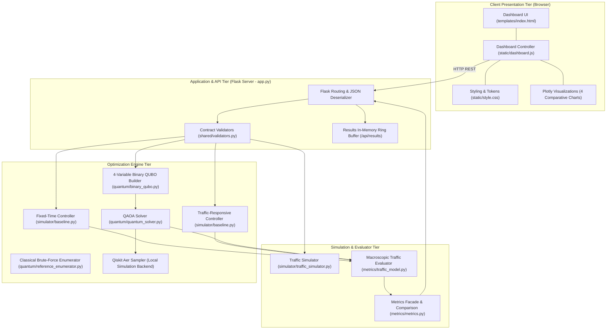
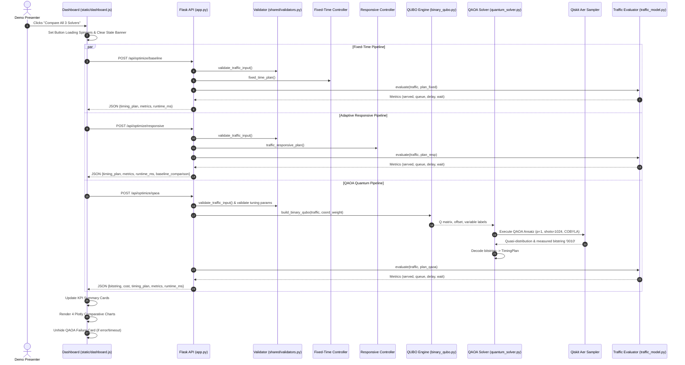

# QuantumFlow — System Architecture & Component Design
**Author:** Systems Integrator & Architecture Team  
**Status:** VALIDATED & OPERATIONAL · **Version:** 2.0 (Post-Integration)

---

## 1. Architectural Principles

QuantumFlow was engineered around four fundamental architectural guarantees:

1. **Single Source of Truth for Traffic Evaluation:**
   Neither the frontend, the Flask API, the baseline controllers, nor the quantum solver compute independent queue delay metrics. All performance indicators (served vehicles, remaining queues, total delay seconds, average wait time) are exclusively calculated by [`metrics/traffic_model.py`](../metrics/traffic_model.py).

2. **Strict Non-Fabrication Guarantee:**
   Classical exhaustive search is **never** substituted for quantum optimization. If the QAOA quantum circuit simulation times out or encounters a simulation exception, the system returns `status="error"` or `"timeout"` with `cost=None` and an equal-split fallback plan. A successful quantum result is never fabricated.

3. **Multi-Controller Parity on Identical Traffic Snapshots:**
   Every optimization request (Fixed-Time, Traffic-Responsive, QAOA) evaluates against the exact same vehicle counts. Results are displayed side-by-side on identical axes with units clearly labeled (`veh`, `s`, `ms`).

4. **Stale State Invalidation:**
   Any modification to input queue counts immediately invalidates previously rendered metrics, warning the user and preventing stale data from masquerading as current simulation results.

---

## 2. End-to-End System Architecture

---

## 3. Data Flow & Execution Sequence

When a user triggers an optimization (or scenario selection), the execution follows a deterministic multi-stage sequence:

---

## 4. Component Deep Dive

### 4.1 Traffic Simulator (`simulator/`)
- **`traffic_simulator.py`:** Manages the internal 4-intersection grid state. Tracks instantaneous vehicle queues for North-South (`ns_count`) and East-West (`ew_count`) approaches across nodes A, B, C, D. Supports random reproducible scenarios (`light`, `medium`, `heavy`, `zero`) via integer seeds.
- **`baseline.py`:** Provides deterministic classical signal controllers:
  - `fixed_time_plan()`: Fixed 30s NS / 30s EW splits.
  - `traffic_responsive_plan()`: Ratio-based adaptive splits bounded to $[15\text{ s}, 45\text{ s}]$.

### 4.2 Shared Constraints & Types (`shared/`)
- **`types.py`:** Authoritative `TypedDict` schemas for `ApproachTiming`, `TimingPlan`, `Metrics`, `SolverResult`, and `TrafficInput`.
- **`validators.py`:** Enforces mathematical boundaries:
  - Cycle conservation: $ns\_green + ew\_green = 60\text{ s}$.
  - Min/Max bounds: $15\text{ s} \le green \le 45\text{ s}$.
  - Integer queue counts $\ge 0$.

### 4.3 Macroscopic Traffic Model & Metrics (`metrics/`)
- **`traffic_model.py`:** Core macroscopic physics simulation:
  - Saturation headway: $h = 2.0\text{ s/veh}$.
  - Vehicle discharge capacity: $C(g) = \lfloor g / 2.0 \rfloor$.
  - Leftover vehicles accumulate opposing red delay: $D = rem_{ns} \cdot ew_{green} + rem_{ew} \cdot ns_{green}$.
- **`metrics.py`:** Computes comparative percentages (`delay_reduction_pct`, `wait_reduction_pct`) relative to the fixed-time baseline with division-by-zero guards.

### 4.4 Quantum Optimization Layer (`quantum/`)
- **`binary_qubo.py`:** Formulates the $N=4$ binary decision model. Maps local intersection delay to linear diagonal terms $Q_{ii}$ and corridor synchronization to quadratic coupling terms $Q_{uv}$. Proves algebraic energy equality $E(x) \equiv C_{intended}(x)$ across all 16 bitstrings.
- **`reference_enumerator.py`:** Evaluates all $2^4 = 16$ candidate plans by brute force to provide exact analytical ground truth.
- **`quantum_solver.py`:** Converts the QUBO matrix into a Qiskit `QuadraticProgram` and executes genuine QAOA on `qiskit_aer.primitives.Sampler`. Includes an internal 30-second execution watchdog timer.

### 4.5 Web API Tier (`app.py`)
- Built on **Flask 3.0.3**.
- Encapsulates all algorithm execution behind uniform REST endpoints.
- Validates request payloads and catches solver exceptions gracefully, returning structured JSON error schemas (`{"status": "error", "message": "..."}`) without leaking stack traces.

### 4.6 Frontend Presentation Tier (`templates/`, `static/`)
- Built on Vanilla HTML5, CSS3, JavaScript (ES6+), and **Plotly.js**.
- No heavy frontend frameworks or build steps required.
- Four interactive comparative charts:
  1. *Estimated Total Delay & Average Waiting Time*
  2. *Vehicles Served vs Remaining Queues*
  3. *Approach Green-Light Durations (NS vs EW per Node)*
  4. *Solver Computational Runtime Latency*
- Includes dynamic density tagging (`Low`, `Moderate`, `High`, `Congested`) and automatic stale input invalidation.

---

## 5. Architectural Invariant & Regression Testing

The system architecture is protected by **428 automated tests** executed via `pytest`:
- **Interface compliance:** Validates that all controller outputs match `SolverResult` typed dictionaries.
- **Cycle invariance:** Proves that all candidate decodings obey cycle and boundary constraints.
- **Zero-traffic safety:** Confirms that 0-vehicle scenarios evaluate without division-by-zero exceptions.
- **Non-fabrication validation:** Tests simulated solver exceptions and timeouts to confirm that artificial quantum speedup is never claimed.
